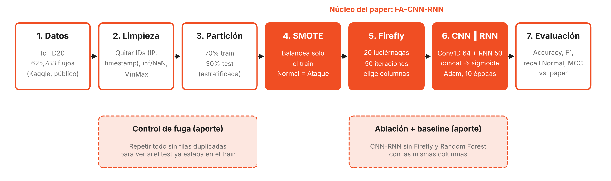

# Réplica de FA-CNN-RNN para detección de intrusiones IoT (IoTID20)

Réplica experimental del artículo:

> Zayed, S. M., Alshathri, S., & El-Shafai, W. (2026). *Firefly Algorithm Optimized Hybrid Deep Learning Framework for Intrusion Detection in IoT Environments*. International Journal of Computational Intelligence Systems, 19, 158. https://doi.org/10.1007/s44196-026-01178-2

Curso **Propuesta de Investigación 2026-2**, Ingeniería de Sistemas, Universidad de Lima. Semana 13: replicar un artículo.

## Qué hace el modelo

Un IDS (sistema de detección de intrusiones) que clasifica cada flujo de red de una casa inteligente como **normal** o **ataque**:

1. **SMOTE** crea ejemplos sintéticos de la clase minoritaria, pero solo en entrenamiento.
2. El **Firefly Algorithm** busca qué columnas usar. Cada luciérnaga es un subconjunto de columnas, brilla más si detecta mejor con menos columnas, y las demás se mueven hacia las que brillan más.
3. La red **CNN-RNN** tiene dos ramas en paralelo. Una Conv1D busca patrones entre columnas vecinas y una RNN las lee como secuencia. Las dos se concatenan antes de la salida sigmoide.



## Experimentos

| ID | Qué prueba | Por qué |
|---|---|---|
| E0 | Auditoría: desbalance, duplicados exactos, % del test que ya aparece en train | Saber si la partición aleatoria infla las métricas |
| E1 | **Réplica fiel**: 70/30 + SMOTE + Firefly + CNN-RNN (10 épocas, batch 64) | Comparar con el 98.2% del paper |
| E2 | Ablación: CNN-RNN sin Firefly | El paper reporta 94.2% |
| E3 | Baseline: Random Forest con las mismas columnas | ¿Hace falta deep learning? |
| E4 | E1 y E3 **sin filas duplicadas** | Control de fuga de información |

## Resultados

<!-- RESULTADOS:INICIO -->
*Se llenan automáticamente al ejecutar el notebook (`scripts/update_readme.py`).*
<!-- RESULTADOS:FIN -->

## Cómo ejecutarlo

### Opción A: Google Colab (recomendado)

Abre `notebooks/replica_FA_CNN_RNN_IoTID20.ipynb` en Colab, elige **Entorno de ejecución → GPU** y ejecuta todo. El notebook clona este repo, descarga IoTID20 de Kaggle con `kagglehub` (sin login) y corre los cinco experimentos.

### Opción B: local

```bash
pip install -r requirements.txt
python run_experiments.py                  # descarga IoTID20 de Kaggle
python run_experiments.py --data ruta.csv  # o usa tu CSV
python run_experiments.py --fast           # batch 256: ~4x más rápido, menos fiel
python scripts/update_readme.py            # pega los resultados en este README
```

Para probar el pipeline sin descargar nada: `python scripts/make_synthetic.py data/sint.csv 15000 && python run_experiments.py --data data/sint.csv --fast` (esos números **no** son resultados).

## Datos

**IoTID20** (Ullah & Mahmoud, 2020): 625,783 flujos extraídos con CICFlowMeter de una casa inteligente con un parlante SKT NUGU y una cámara EZVIZ. Es público para uso académico. Las copias usadas son [Kaggle `rohulaminlabid/iotid20-dataset`](https://www.kaggle.com/datasets/rohulaminlabid/iotid20-dataset) y [la página de los autores](https://sites.google.com/view/iot-network-intrusion-dataset).

El paper también usa NF-BoT-IoT-v2 (1.9 M flujos, Universidad de Queensland). Esta réplica se limita a IoTID20 por tiempo de cómputo.

## Supuestos de la réplica

El paper indica que el código y los datos están *"available upon request from the corresponding author"*, así que el pipeline se reconstruyó desde el texto. Lo que el paper **no especifica** se resolvió así (todo está en `src/config.py`):

| Detalle no especificado | Decisión |
|---|---|
| Tipo de RNN (LSTM/GRU/simple) | `SimpleRNN`; el paper solo menciona GRU como trabajo futuro |
| Clasificador del fitness del Firefly | Árbol de decisión (profundidad 10) sobre 10,000 filas |
| Fórmula del fitness | `0.99·accuracy + 0.01·(1 − k/n)` |
| β del Firefly | 0.1. El paper lo describe a la vez como aleatoriedad y como atracción |
| Columnas eliminadas | Flow_ID, Src_IP, Dst_IP, Timestamp y las columnas constantes |
| k de SMOTE | 5 |
| Normalización | MinMax ajustado solo en train |

## Estructura

```
├── run_experiments.py        # orquesta E0–E4
├── src/
│   ├── config.py             # hiperparámetros ([PAPER] vs [SUPUESTO])
│   ├── data.py               # carga, limpieza, auditoría, SMOTE
│   ├── firefly.py            # Firefly Algorithm binario
│   ├── model.py              # CNN-RNN en Keras
│   └── evaluate.py           # métricas y gráficas
├── notebooks/                # notebook para Colab
├── scripts/                  # datos sintéticos, diagrama, README
├── results/                  # metrics.csv, summary.json
└── figures/                  # matrices de confusión, convergencia, comparación
```

## Referencias

- Zayed, S. M., Alshathri, S., & El-Shafai, W. (2026). Int. J. Comput. Intell. Syst., 19, 158.
- Ullah, I., & Mahmoud, Q. H. (2020). A Scheme for Generating a Dataset for Anomalous Activity Detection in IoT Networks. Canadian AI 2020.

Autor de la réplica: Bruno Castillo (Universidad de Lima). Código bajo licencia MIT.
